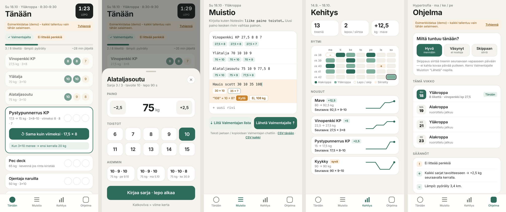

# Treeni Liukuri

Valmentajan ohjelma sisään, sarjat ulos — yksi näkymä salilla.

Training log PWA (Finnish UI). Vaadin 25 + Hilla (React) + Spring Boot 4, Java 21. All training
data stays in the browser (localStorage), so the installed app works offline. See
[SCOPE.md](SCOPE.md) for phases, data model, parser grammar and open questions.



<sub>Screenshots of the running app (production build, built-in demo data).</sub>

## Screens

<table>
  <tr>
    <td align="center" width="33%"><br><b>Tänään</b><br>Today's exercises with target and last result, set dots, rest timer, and one-tap <i>Sama kuin viimeksi</i>.</td>
    <td align="center" width="33%"><br><b>Sarja</b><br>Bottom sheet: weight ±2,5 kg, reps grid, last 3 sessions, <i>Kirjaa sarja · lepo alkaa</i>.</td>
    <td align="center" width="33%"><br><b>Muistio</b><br>Type like Notes (<code>Kyykky 80 9 8 10</code>), parsed live into weight × reps chips, with one-tap fixes.</td>
  </tr>
  <tr>
    <td align="center"><br><b>Kehitys</b><br>5-week training rhythm and trend lines for the main lifts with the next target.</td>
    <td align="center"><br><b>Ohjelma</b><br><i>Miltä tuntuu tänään?</i>, this week's plan, and the progression rules.</td>
    <td align="center" valign="middle"><b>Offline-first PWA</b><br>Install from the browser; all data stays on the device. Export as text or CSV.</td>
  </tr>
</table>

## Requirements
- JDK 21+ (Maven comes with `./mvnw`)
- Node.js is optional: the Vaadin plugin downloads one to `~/.vaadin` when needed. Running the
  unit tests via `mvn test` uses `npx` from your PATH.

## Run (development)
```bash
./mvnw                       # = spring-boot:run, http://localhost:8080 (Vite hot reload)
```

## Tests
```bash
npm install && npx vitest run      # parser, plan paste, rules, export (35 tests)
./mvnw test                        # same tests from Maven (skip with -DskipTests)
```

## Production build
```bash
./mvnw -Pproduction package
java -jar target/treeni-liukuri-1.0-SNAPSHOT.jar      # PORT env var overrides 8080
```
The production build includes the PWA manifest and service worker (offline). Dev mode doesn't
register the service worker.

## Docker
```bash
docker build -t treeni-liukuri .
docker run -p 8080:8080 treeni-liukuri
```

## Deploy a test URL

### Fly.io (recommended)
`fly.toml` is included (region `arn` Stockholm, 512 MB, scales to zero when idle).
1. Create a Fly.io account and add a payment card (Fly asks for one even when usage stays small).
2. `curl -L https://fly.io/install.sh | sh && fly auth login`
3. `fly launch --copy-config --no-deploy` (pick a unique app name if `treeni-liukuri` is taken), then `fly deploy`
4. Open `https://<app>.fly.dev`. HTTPS is automatic, which the PWA install and the service worker need.

### Render (alternative, no card)
`render.yaml` is included. Render dashboard → New → Blueprint → connect the GitHub repo
(Render's GitHub app needs access to the repo). The free web service sleeps after
inactivity (~1 min cold start for a Spring Boot app).

## Data & privacy
Nothing leaves the device unless you tap **Lähetä Valmentajalle** (share/clipboard) or download a
CSV. There is no Google Sheets sync. That's a later, opt-in phase (the Treenipäiväkirja sheet
belongs to Valmentaja).

## License
MIT, see [LICENSE](LICENSE).
